# KAVI Engineering — Public Evidence Index (October 2026)

**Onur Kavi · AI Systems Engineering / Agent Infrastructure / Reliability**

This index is an **engineering portfolio**, not a vendor capability checklist or a claim of production-wide performance. Each proof points to running code or documented evaluation boundaries. The animations below are lightweight, self-contained SVG explainers; separate **20-second silent MP4** renders are available as downloadable presentation assets, not yet embedded as hosted MP4 files.

## 01. Execution authority — KAVI Capability Compiler

> **Thesis:** A model can request a tool; only a bounded host grant should allow it to execute.

- [Source code](https://github.com/kOs-tile/kavi-capability-compiler) · [Five-minute demo](https://github.com/kOs-tile/kavi-capability-compiler/blob/main/examples/recruiter_demo.py) · [Demo walkthrough](https://github.com/kOs-tile/kavi-capability-compiler/blob/main/docs/DEMO_5_MINUTES.md)
- An allowed read reaches the host callback once. An ungranted delete, wrong customer ID, additional parameter, expiry and approval-required path do not.
- The test asserts **zero denied dispatches**, not merely that a model says "denied."
- This is a trusted in-process demonstration of KCC's shipped stable public SDK; not a production penetration test or a guarantee against host code bypassing Guard.

## 02. Durable tasks — SPECTRAFLOW reliability proof

> **Thesis:** Completion must be verified at the environment and persisted as evidence; retry must respect external effects.

- [Source code](../examples/reliability_interview_demo.py) · [Five-minute walkthrough](RELIABILITY_INTERVIEW_DEMO.md) · [Automated tests](../tests/test_reliability_interview_demo.py)
- 12 deterministic checks in a **synthetic, isolated SQLite reference runner**: actor isolation, immutable terminal history, a fresh continuation, bounded pre-model retry and persistence.
- The existing synthetic side-effect benchmark shows a blind post-commit retry causes **2 ledger commits** while a stable idempotency key produces **1**; these are not real external payments.
- The separate sanitized KAVI historical task fixture has **8 records**: 2 verified PASS, 2 completed-but-unverified and 4 failures. It cannot establish real committed side-effect totals.
- The proposed 80-run live comparative experiment is **not complete**.

## 03. System-level research

**[The Anatomy of a Production-Grade Agentic System — 14 layers, 7 loops, 5 graphs, memory, authority, and evidence](../research/ANATOMY_OF_PRODUCTION_AGENTIC_SYSTEMS_2026.md)**

This referenced technical essay compares deterministic workflows and agents, then proposes the boundaries between task state, context, model decisions, skill/tool discovery, scoped permission, dispatch, memory writes, retrieval graphs, fault recovery, and evaluation.

It is a source-grounded engineering reference architecture, **not** a peer-reviewed experimental paper or a claim that every proposed KAVI component is production deployed.

### Interview reading order

1. Run [KCC's five-minute authority demo](https://github.com/kOs-tile/kavi-capability-compiler/blob/main/docs/DEMO_5_MINUTES.md).
2. Run [SPECTRAFLOW's five-minute recovery demo](RELIABILITY_INTERVIEW_DEMO.md).
3. Read the architecture research note and compare each proposed layer with the shipped proof table in its §11.
4. Challenge the boundaries: bypassing Guard; post-commit timeout; cross-actor claims; stale memory; semantic verification without receipts.

*Research and evidence frozen as viewed on October 12, 2026. Revisit source repos for changed baselines, updated published releases or subsequent live-trial evidence.*
