# KAVI Agent Reliability — 5-minute engineering evidence demo

A reproducible, no-credentials companion to the [KAVI Shared Execution Reliability case study](https://github.com/kOs-tile/kOs-tile/blob/main/case-studies/kavi-runtime-reliability.md) and SPECTRAFLOW's existing synthetic and sanitized historical benchmarks.

## Motion explainer — durable verification



**Watch it alongside the executable demo.** The animation depicts intended task transitions and a failed verification leading to a fresh continuation; actual counts and test evidence are in the source below. See the [public evidence portfolio](https://kavi-engineering-evidence.vercel.app/).

## Run from the SPECTRAFLOW checkout

Python 3.11+:

```bash
python examples/reliability_interview_demo.py
python -m pytest -q tests/test_reliability_interview_demo.py
```

The demonstration itself makes no API, model, external network or production calls. Only Python's standard library is used by the new synthetic SQLite reference model. The full demo imports existing SPECTRAFLOW benchmark evaluators; the test command needs `pytest`. Run only the self-contained new controls with:

```bash
python examples/reliability_interview_demo.py --controls-only
```

## Five-minute interview flow

| Timing | Run / explain | Evidence |
| --- | --- | --- |
| 0:00–0:45 | Incorrect actor attempts Work-owned task; correct Work actor completes it | Wrong actor blocked before invocation; explicit ownership |
| 0:45–1:40 | Process exits successfully but has no terminal PASS marker | Process exit 0 does not become semantic acceptance |
| 1:40–2:30 | Immutable failure and audit history; fresh continuation; reopen SQLite | Failure not rewritten as PASS; persistence of task and event state |
| 2:30–3:20 | Inject pre-model failure 3 times | Initial attempt + at most 2 retries; no model work for preflight failures |
| 3:20–4:15 | Run the existing SPECTRAFLOW execution-trace benchmark | Synthetic blind post-commit retry commits **2** effects, stable idempotency key commits **1** |
| 4:15–5:00 | Run existing sanitized KAVI runtime-trace evaluator | **8 records**: **2 verified PASS**, **2 completed-unverified**, **4 explicit failures** |

The terminal success marker is `KAVI_RELIABILITY_DEMO: PASS`. A machine-readable `EVIDENCE_JSON=` line contains precise counts, source revision, and the declared evidence boundary. Assertion failure means a nonzero process exit.

## Three distinct evidence sources

1. **New, purely synthetic reference controls.** `examples/reliability_interview_demo.py` contains an isolated SQLite state machine. It models actor ownership, retry budget, idempotency identity, immutable terminal states, fresh continuation and state persistence. It **is not** the live KAVI/Hermes runner; SQLite triggers in a local demonstration are not tamper-proof against database administrators.
2. **Pre-existing synthetic real Python callable execution.** `benchmark.execution_traces` shows the actual callback/ledger mechanics of unsafe blind retry vs stable idempotency. Its side effects are **in-memory synthetic receipts**, not production transactions.
3. **Pre-existing sanitized historical KAVI task metadata.** `benchmark.kavi_runtime_traces` evaluates source-bound metadata from `kOs-tile/kavi-codex-state`, revision `9491db887bbb757b7180fb84b23cc82c2760a2be`. Since it does **not** contain committed-side-effect counts, those counts stay unavailable.

This demo does not change any live task queue, approval, credential, Hermes worker, model configuration, or production deployment. The SPECTRAFLOW live comparative 80-run evaluation remains **planned/not yet evidenced**. An illustrative reference runner plus narrow historical traces does not prove a production reliability percentage or universal exactly-once guarantee.

## Reviewer links

- [Runtime failure-to-fix case study](https://github.com/kOs-tile/kOs-tile/blob/main/case-studies/kavi-runtime-reliability.md)
- [Reliability methodology and evidence boundaries](RELIABILITY_VALIDATION.md)
- [Synthetic execution trace code](../benchmark/execution_traces.py)
- [Historical runtime benchmark](../benchmark/kavi_runtime_traces.py)
- [Sanitized history fixture](../benchmark/fixtures/kavi_runtime_trace_v0.json)
